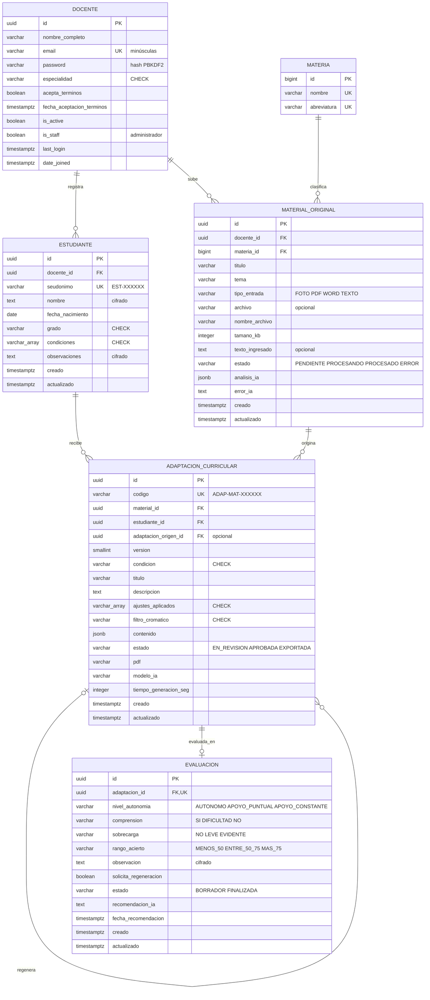

# MER – Maestro Sombra (PostgreSQL 17)

Pega el bloque en https://mermaid.live y descárgalo como PNG o SVG.

## Reglas de negocio (van debajo del diagrama en el documento)

1. Un docente puede registrar como máximo 3 estudiantes con NEE (trigger en PostgreSQL).
2. Una adaptación solo puede usar una condición que el estudiante tenga registrada.
3. Cada regeneración crea una versión nueva (`version` + 1) que apunta a la anterior (`adaptacion_origen_id`).
4. Cada versión tiene como máximo una evaluación.
5. Una evaluación finalizada debe tener al menos la autonomía y la comprensión.
6. Un material de tipo TEXTO lleva `texto_ingresado`; los de tipo FOTO, PDF o WORD llevan `archivo`.
7. A Gemini se envían el material y la condición; nunca el nombre ni las observaciones del niño.

## Leyenda

- **PK**: clave primaria.
- **FK**: clave foránea.
- **UK**: valor único.
- **cifrado**: se guarda cifrado con Fernet.
- **CHECK**: solo admite los valores del catálogo.
- **jsonb**: respuesta estructurada de la IA.
