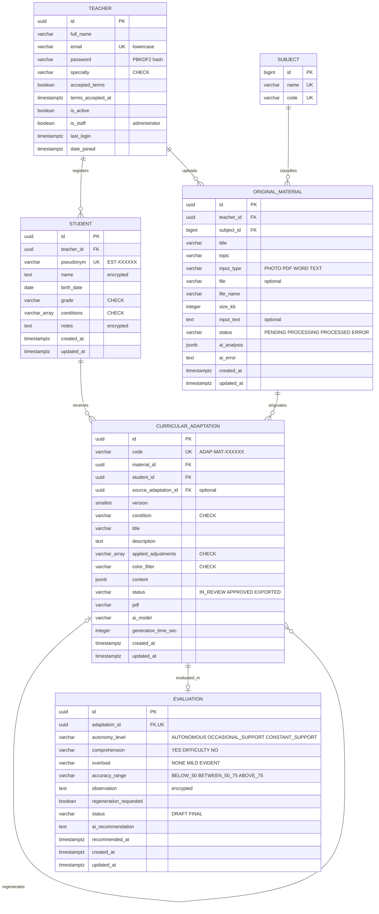

# MER – Maestro Sombra (PostgreSQL 17)

Pega el bloque en https://mermaid.live y descárgalo como PNG o SVG.

Las tablas y columnas están en inglés, igual que las que crea Django (`auth_group`, `django_session`). Lo que ve el usuario está en español.

## Nombres de las tablas en PostgreSQL

Django antepone el nombre del módulo a cada tabla:

| Entidad del MER | Tabla en PostgreSQL | Qué guarda |
|---|---|---|
| TEACHER | `accounts_teacher` | Docentes y administrador |
| SUBJECT | `materials_subject` | Catálogo fijo de materias de EGB |
| STUDENT | `students_student` | Estudiantes con NEE (máx. 3 por docente) |
| ORIGINAL_MATERIAL | `materials_originalmaterial` | Guía que sube el docente |
| CURRICULAR_ADAPTATION | `adaptations_curricularadaptation` | Guía adaptada por la IA |
| EVALUATION | `evaluations_evaluation` | Evaluación del docente en el aula |

## Reglas de negocio (van debajo del diagrama en el documento)

1. Un docente puede registrar como máximo 3 estudiantes con NEE (trigger `tr_max_students_per_teacher` en PostgreSQL).
2. Una adaptación solo puede usar una condición que el estudiante tenga registrada.
3. Cada regeneración crea una versión nueva (`version` + 1) que apunta a la anterior (`source_adaptation_id`).
4. Cada versión tiene como máximo una evaluación.
5. Una evaluación finalizada (`FINAL`) debe tener al menos la autonomía y la comprensión.
6. Un material de tipo TEXT lleva `input_text`; los de tipo PHOTO, PDF o WORD llevan `file`.
7. A Gemini se envían el material y la condición; nunca el nombre ni las observaciones del niño.

## Leyenda

- **PK**: clave primaria.
- **FK**: clave foránea.
- **UK**: valor único.
- **encrypted**: se guarda cifrado con Fernet.
- **CHECK**: solo admite los valores del catálogo.
- **jsonb**: respuesta estructurada de la IA.
