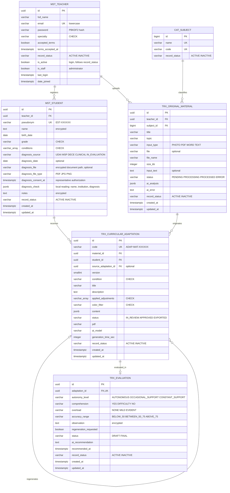

# MER – Maestro Sombra (PostgreSQL 17)

Pega el bloque en https://mermaid.live y descárgalo como PNG o SVG.

Las tablas y columnas están en inglés; lo que ve el usuario está en español. Cada tabla lleva un prefijo que indica su tipo (ver "Tipos de tablas") y un campo `record_status` con el estado del registro.

## Tipos de tablas

| Prefijo | Tipo | Qué guarda | Tablas |
|---|---|---|---|
| `cat_` | Catálogo (paramétrica) | Valores fijos que se eligen de una lista; casi no cambian | `cat_subject` |
| `mst_` | Maestra | Entidades principales que existen por sí mismas y se usan en muchos procesos | `mst_teacher`, `mst_student` |
| `trx_` | Transaccional | Registros que nacen del trabajo diario; dependen de las maestras y crecen con el uso | `trx_original_material`, `trx_curricular_adaptation`, `trx_evaluation` |
| `auth_`, `django_` | Sistema | Tablas del framework: permisos, sesiones, historial de migraciones | `auth_group`, `auth_permission`, `django_session`, `django_migrations`, `django_admin_log`, `django_content_type`, `mst_teacher_groups`, `mst_teacher_user_permissions` |

`trx_curricular_adaptation` además resuelve la relación muchos a muchos entre material y estudiante (tabla intermedia con datos propios).

Las listas cortas y cerradas (condiciones, grados, especialidades, estados) no son tablas: son catálogos de valores controlados con restricciones `CHECK`.

## Estado del registro (`record_status`)

Todas las tablas del negocio tienen `record_status` con dos valores: `ACTIVE` (activo) e `INACTIVE` (inactivo).

- Es un **borrado lógico**: un registro inactivo deja de mostrarse en la aplicación, pero no se borra, para conservar el historial (trazabilidad).
- Es distinto de `status`, que indica en qué paso del proceso está un material, una adaptación o una evaluación.
- Un `CHECK` (`<tabla>_record_status_valid`) solo admite esos dos valores.
- En el docente, `record_status = INACTIVE` desactiva también `is_active`, así no puede iniciar sesión.
- El trigger del máximo de 3 estudiantes solo cuenta a los estudiantes activos.

## Nomenclatura

| Elemento | Regla | Ejemplo |
|---|---|---|
| Tablas | Prefijo de tipo + sustantivo en singular, inglés, `snake_case` | `mst_student`, `trx_curricular_adaptation` |
| Clave primaria | `id` | `id` |
| Clave foránea | Nombre de la entidad + `_id` | `teacher_id`, `material_id` |
| Booleanos | Afirmación (`is_`, verbo en participio) | `is_active`, `accepted_terms`, `regeneration_requested` |
| Fecha | Sufijo `_date` | `birth_date` |
| Fecha y hora | Sufijo `_at` | `created_at`, `terms_accepted_at` |
| Medidas | Sufijo con la unidad | `size_kb`, `generation_time_sec` |
| Estado del proceso | `status` | `status` |
| Estado del registro | `record_status` | `record_status` |
| Datos de la IA | Prefijo `ai_` | `ai_analysis`, `ai_model` |
| Restricciones | Entidad + regla | `student_grade_valid`, `teacher_email_lowercase` |
| Trigger y función | `tr_` y `fn_` + regla | `tr_max_students_per_teacher`, `fn_max_students_per_teacher` |

## Reglas de negocio (van debajo del diagrama en el documento)

1. Un docente puede tener como máximo 3 estudiantes activos (trigger `tr_max_students_per_teacher` en PostgreSQL).
2. Una adaptación solo puede usar una condición que el estudiante tenga registrada.
3. Cada regeneración crea una versión nueva (`version` + 1) que apunta a la anterior (`source_adaptation_id`).
4. Cada versión tiene como máximo una evaluación.
5. Una evaluación finalizada (`FINAL`) debe tener al menos la autonomía y la comprensión.
6. Un material de tipo TEXT lleva `input_text`; los de tipo PHOTO, PDF o WORD llevan `file`.
7. A Gemini se envían el material y la condición; nunca el nombre ni las observaciones del niño.
8. Los registros no se borran desde la aplicación: se marcan como `INACTIVE`.
9. Dislexia o discalculia (DEA) no se registran junto con discapacidad intelectual (DSM-5, criterio D) y solo se admite un nivel de discapacidad intelectual (`student_no_learning_disorder_with_id`, `student_single_id_level`).
10. El diagnóstico se respalda con un documento (informe de la UDAI, certificado o carné del MSP, informe del DECE o diagnóstico clínico) con fecha (o con el documento adjunto), o queda "en proceso de evaluación"; la discapacidad intelectual se respalda con el MSP o la UDAI. Opcionalmente se adjunta el documento: solo con la autorización del representante (fecha en `diagnosis_consent_at`), cifrado en disco, visible solo para su docente, leído solo en el servidor para avisar si no coincide el nombre, la institución o el diagnóstico, nunca enviado a la IA y borrado al dar de baja al estudiante (`student_document_has_consent`, `student_document_needs_source`).

## Leyenda

- **PK**: clave primaria.
- **FK**: clave foránea.
- **UK**: valor único.
- **encrypted**: se guarda cifrado con Fernet.
- **CHECK**: solo admite los valores del catálogo.
- **jsonb**: respuesta estructurada de la IA.
